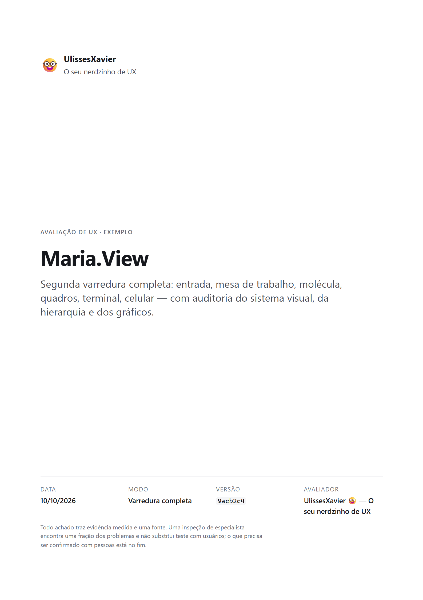
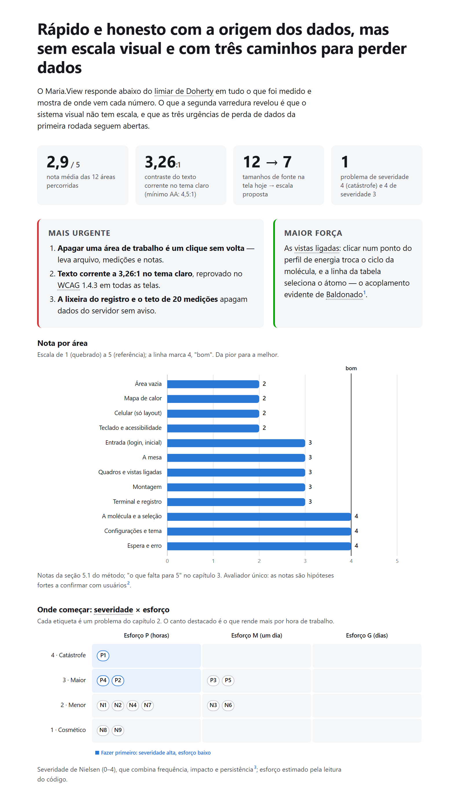
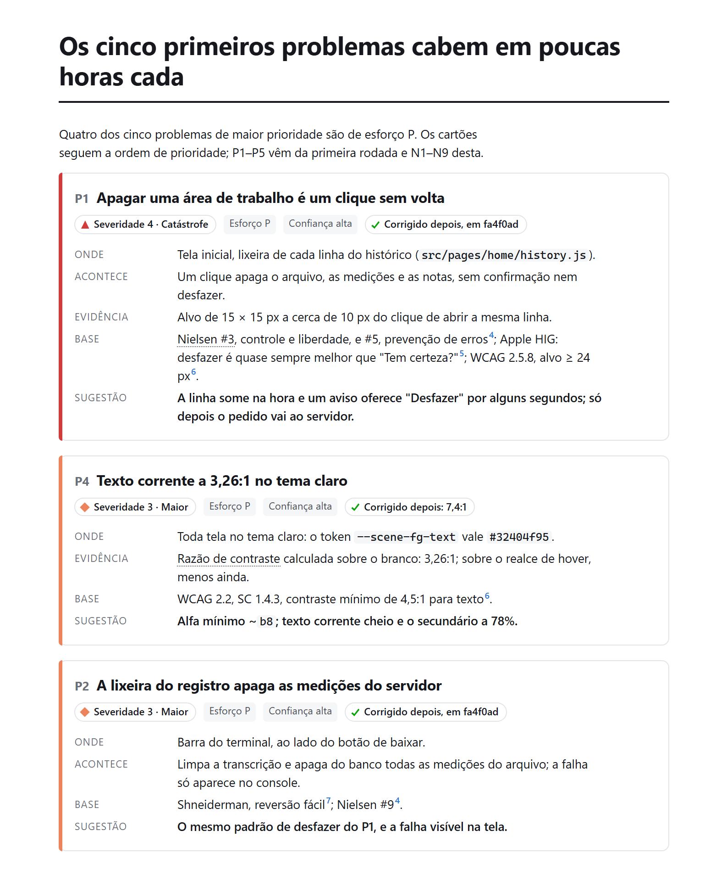
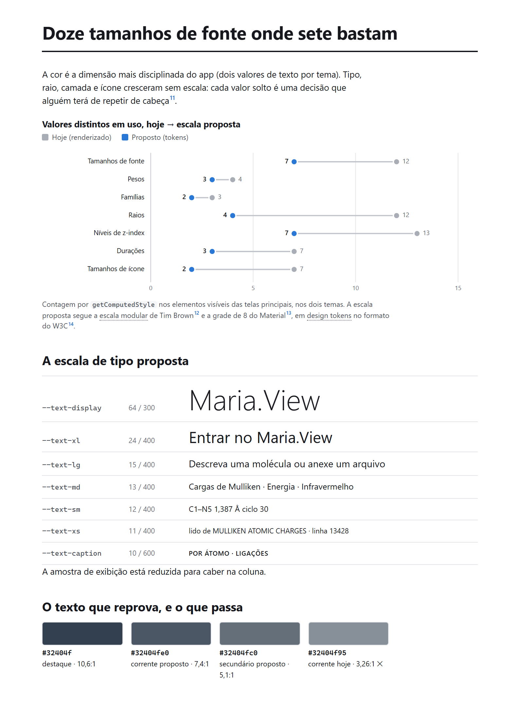
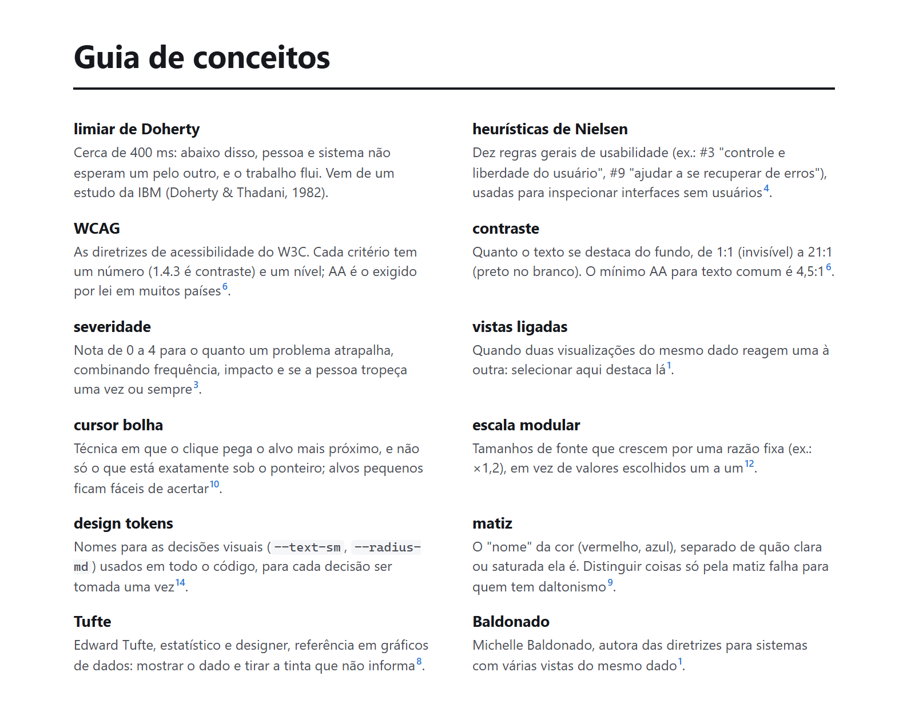

<div align="center">

# `/ulissesxavier:ux-evaluate`

### UlissesXavier 🤓 — *o seu nerdzinho de UX*

**Um avaliador de UX/UI para o Claude Code que não opina: mede e cita.**

[](https://code.claude.com/docs/en/plugins)
[](CHANGELOG.md)
[](LICENSE)

[English version](README.en.md)

&nbsp;

</div>

O UlissesXavier é um agente para o [Claude Code](https://code.claude.com).
Ele abre o seu app web no Chrome, percorre todas as telas e gestos, tenta
quebrar, mede o que dá para medir e entrega um relatório com notas de 1 a 5
por área, problemas por prioridade e, para cada nota, **o que falta para
chegar a 5**. Sai em markdown, para você ajustar com o seu Claude, e em PDF
diagramado, para ler e mandar para a equipe.

A regra que o define: **sem fonte, não há achado.** Toda afirmação traz a
evidência (o que ele fez, o número que mediu, a captura) e a base (o
princípio, com a referência): normas e pesquisa revisada por pares (WCAG 2.2,
CHI, IEEE VIS), as diretrizes publicadas dos grandes nomes da área (Apple
HIG, Material e web.dev do Google, Figma, Canva, Nielsen Norman Group,
Baymard, GOV.UK) e a psicologia de quem usa. O que ele suspeita e não
consegue fundamentar não vira problema: vira pergunta para testar com
usuários.

## Começar em um minuto

Requisitos: [Claude Code](https://code.claude.com) e a extensão
[Claude in Chrome](https://code.claude.com/docs/en/chrome) conectada.

```
/plugin marketplace add MatheusAraripe/UlissesXavier
/plugin install ulissesxavier@ulissesxavier
```

Depois, no seu projeto:

```
/ulissesxavier:ux-profile          ← uma vez: quem usa o seu produto
/ulissesxavier:ux-evaluate         ← a avaliação completa
/ulissesxavier:ux-evaluate só o celular
```

Ligue a [atualização automática](#atualizações-automáticas) para receber as
versões novas sozinho.

## O que você recebe

Um relatório que segue os princípios que ele mesmo cobra: o essencial nas
duas primeiras páginas, cada problema num cartão com a evidência e a fonte,
gráficos feitos com os números medidos, e um guia que explica cada conceito
para quem não é da área.

<table>
<tr>
<td width="33%" valign="top"></td>
<td width="33%" valign="top"></td>
<td width="33%" valign="top"></td>
</tr>
<tr>
<td valign="top"><b>Problemas por prioridade.</b> Severidade por forma, palavra e cor; onde acontece, a evidência medida, a base com a fonte e a sugestão.</td>
<td valign="top"><b>O sistema visual.</b> Quantos tamanhos, pesos, raios e camadas o app usa de verdade, e a escala proposta como tokens.</td>
<td valign="top"><b>Guia de conceitos.</b> Cada termo, teoria e autor citado, em linguagem simples; no PDF, a primeira menção liga ao verbete.</td>
</tr>
</table>

Veja o [PDF de exemplo completo](examples/maria-view/relatorio-exemplo.pdf)
e o [markdown que o gerou](examples/maria-view/relatorio-exemplo.md).

## O que ele avalia

| Área | Como | Base |
|---|---|---|
| Usabilidade | as tarefas reais de cada persona, heurísticas, percurso cognitivo do novato | Nielsen & Molich; Shneiderman; Wharton et al. |
| Psicologia e emoção | o que a pessoa espera, o que deixa de ver, o que precisa guardar de cabeça, o que sente (primeira impressão, confiança, espera, o pior momento e o fim de cada tarefa) e o que empurra as decisões | Norman (*Emotional Design*); Lindgaard et al.; Tuch et al. (Google); Fogg et al. (Stanford); Pirolli & Card; Cowan; Kahneman; Peters, Calvo & Ryan; W3C COGA |
| Esforço | passos e tempo previsto por tarefa | Keystroke-Level Model (Card, Moran & Newell) |
| Velocidade percebida | LCP, INP, CLS e tarefas longas medidos no navegador | Core Web Vitals (web.dev) |
| Os cinco estados | ideal, vazio, erro, parcial, carregando, com rede lenta e falha simuladas | UI Stack (Hurff); NN/g |
| Acessibilidade | contraste, alvos, teclado, foco, reflow a 320 px, espaçamento de texto, zoom 200% | WCAG 2.2; WAI-ARIA APG |
| Daltonismo | a tela filtrada por simulação fisiológica | Machado, Oliveira & Fernandes (IEEE TVCG 2009) |
| Sistema visual | tamanhos, pesos, espaçamentos, raios, cores, durações, ícones, e a escala proposta como tokens | escala modular; grade de 8; W3C Design Tokens |
| Hierarquia | testes do olho semicerrado e dos tons de cinza | Treisman; Healey & Enns; NN/g |
| Gráficos e tabelas | canal × tipo de dado, tinta, fator de mentira, escala de cor | Bertin; Mackinlay; Munzner; Tufte; Few |
| Formulários e textos | validação, rótulos, mensagens de erro | Baymard; Wroblewski; GOV.UK; NN/g |
| Ética | padrões enganosos no cadastro, consentimento, planos e cancelamento | Gray et al. (CHI 2018); Mathur et al. (CSCW 2019) |
| Tradução | pseudo-localização: o que corta quando o texto cresce | W3C i18n; Microsoft |
| Recursos de IA | confiança calibrada, procedência, saída manual | Google PAIR |

## Como usar

**1. Primeira vez no projeto: o perfil.** O avaliador precisa saber quem usa
o produto. Rode `/ulissesxavier:ux-profile`: a skill varre o repositório
(README, rotas, campos do cadastro, textos, idiomas), mostra a hipótese dela
sobre o público e faz **poucas perguntas curtas** para completar o que o
código não diz — quem é o usuário principal, a experiência dele, o
dispositivo, a tarefa que precisa ser fácil, o que está em jogo para ele, o
que o avaliador nunca pode tocar. Você responde no próprio chat, em
múltipla escolha (com campo livre), e tudo vai para `.claude/ux-profile.md`,
um markdown comum que você pode editar. Se pular este passo, a primeira
avaliação faz o rascunho do perfil e devolve as perguntas.

**2. A avaliação**, pelo comando, com ou sem foco:

```
/ulissesxavier:ux-evaluate
/ulissesxavier:ux-evaluate só a tela de checkout
/ulissesxavier:ux-evaluate só o que mudou nesta branch
```

ou em linguagem comum: *"use o agente ulissesxavier para avaliar o app"*.
Ele responde **no idioma em que foi chamado** e guarda tudo numa pasta feita
para navegar sem ajuda:

```
feedback/
  README.md                          índice: uma linha por varredura, com nota e link
  2026-10-14/
    v1-varredura-completa/
      ulissesxavier-2026-10-14-v1.md   o relatório (para ajustar com o seu Claude)
      ulissesxavier-2026-10-14-v1.pdf  o mesmo relatório diagramado (para ler e enviar)
      img/                             capturas citadas no relatório
    v2-mobile/                       segunda varredura do mesmo dia
```

A pasta pode ter outro nome; basta indicar no perfil.

**3. O PDF.** Numa varredura completa ele sai sozinho; nos modos com foco,
peça "e exporte em PDF". Quem gera é o Chrome ou o Edge em modo sem janela,
sem instalar nada. Para um relatório que já existe:
`/ulissesxavier:ux-report-pdf`.

### Quando ele trava, ele pergunta

O agente roda em segundo plano e não fala direto com você, mas não desiste
por causa de um bloqueio: uma senha que falta, um servidor que não sobe, uma
escolha que só você pode fazer. Ele avança no que o bloqueio não impede,
salva o progresso no rascunho e devolve a pergunta ao Claude principal, que
te pergunta no chat e **retoma o mesmo agente** com a sua resposta. Só um
"pode pular" seu encerra uma parte, e o relatório diz o que ficou de fora e
por quê.

### Atualizações automáticas

O Claude Code só atualiza sozinho plugins de marketplaces com a atualização
automática ligada, e para marketplaces de terceiros ela vem **desligada**.
Ligue uma vez: `/plugin` → **Marketplaces** → **ulissesxavier** →
**Enable auto-update**. Depois da primeira mensagem de cada sessão, o Claude
Code procura versões novas em segundo plano e avisa
`Plugin updated: ulissesxavier · Run /reload-plugins to apply`. Para
atualizar à mão: `/plugin marketplace update ulissesxavier`. O que mudou em
cada versão está no [CHANGELOG](CHANGELOG.md).

## O que ele não faz

- **Não edita o seu código.** Avalia, mede e propõe.
- **Não substitui teste com pessoas.** Um avaliador especialista encontra uma
  fração dos problemas (Nielsen & Landauer, 1993), e um modelo de linguagem
  não é usuário (NN/g, *Synthetic Users*). Ele nunca afirma o que o usuário
  sente: aponta o risco, com o mecanismo e a fonte, e todo relatório termina
  com o que precisa ser confirmado com gente de verdade.
- **Não deixa rastro.** Sobe os servidores do app sozinho (o comando de cada
  um fica no perfil), reaproveita o que você já tinha rodando sem fechá-lo e,
  no fim, derruba só o que subiu. Logs e PIDs ficam numa pasta temporária
  fora do repositório.
- **Só entra com a conta de teste que você der.** O jeito natural é dizer no
  chat: *"avalie com o login qa@exemplo.com e a senha …"*. Ele nunca cria
  conta e nunca escreve a senha em arquivo, relatório ou resposta.
- **Não apaga dado real.** Fluxos destrutivos são testados interceptando o
  `fetch` da página, com os dados intactos.

## Custo

Uma varredura completa é longa: percorre o app inteiro com capturas de tela.
Para gastar menos sem perder análise, o agente mede com um kit pronto
injetado na página (JSON curto, em vez de código escrito a cada tela),
prefere texto a imagem, escreve o relatório uma vez só (o markdown é a fonte
do PDF), consulta a bibliografia por busca em vez de carregá-la, e não lê o
`CLAUDE.md` do projeto avaliado inteiro — só busca nele as decisões de que
precisa. Para o dia a dia, prefira um foco ("só tipografia e espaçamento")
ou o modo regressão ("só o que mudou nesta branch").

## De onde ele veio

[`examples/maria-view/`](examples/maria-view/) traz o perfil do projeto onde
o agente nasceu: o Maria.View, um app web que lê saídas de química quântica
e desenha a molécula em 3D. As duas primeiras varreduras acharam três
caminhos de perda de dado sem desfazer, texto a 3,26:1 (abaixo do AA) e um
sistema visual com 12 tamanhos de fonte, 12 raios e 13 níveis de `z-index`.
Os três primeiros foram corrigidos na mesma semana.

## Licença

[MIT](LICENSE) © Matheus Araripe
